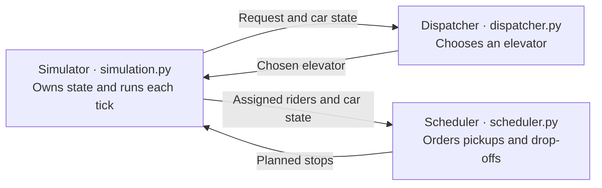

# Elevator simulation

A discrete-time simulation with three dispatchers and LOOK or FIFO stop scheduling.

## Run

Requires **Python 3.11+**, with no runtime dependencies. From the repo directory:

```sh
python3 run.py
```

Choose an example, dispatcher, and scheduler from the numbered menus.
On Windows, use `py run.py`. To skip the menus:

```sh
python3 run.py mixed --dispatcher cost --stop-scheduler fifo
```

Examples: `tiny` for tracing, `mixed` for comparison, and `stress` for load.
Stress has 1,000 requests, 60 floors, and 12 elevators with 8 seats each.
Edit `examples/configs/basic.json` or `stress.json` to change the building.
Use `python3 run.py --help` for custom CSV input and output options.

## Architecture



Dispatchers: **nearest-car**, **direction-aware**, and **cost**. Cost minimizes
predicted added passenger time (waiting plus riding). Schedulers: **LOOK** follows
its sweep; **FIFO** starts with the oldest waiting request. Both support shared rides.

## Assumptions and output

- Cars start at floor 1, serve every floor, and move one floor per tick.
- Boarding and exiting are instantaneous; riders exit before others board.
- Assignments are fixed, capacity is respected, and occupied cars never reverse.
- Only arrived requests affect decisions. Finite inputs are fully served.
- Policies are heuristics, with no guarantee of a globally optimal schedule.

Reports go to `out/<scenario>/<scheduler>/<dispatcher>/`: `positions.csv` records
positions each tick; `summary.json` reports minimum, maximum, and average wait and
total passenger times.

## Tests

```sh
python3 -m venv .venv
.venv/bin/python -m pip install -e '.[dev]'
.venv/bin/python -m pytest -q
```

## Time and improvements

This implementation took me about 4 hours. With more time, I would improve fairness
for older requests and measure larger workloads.
